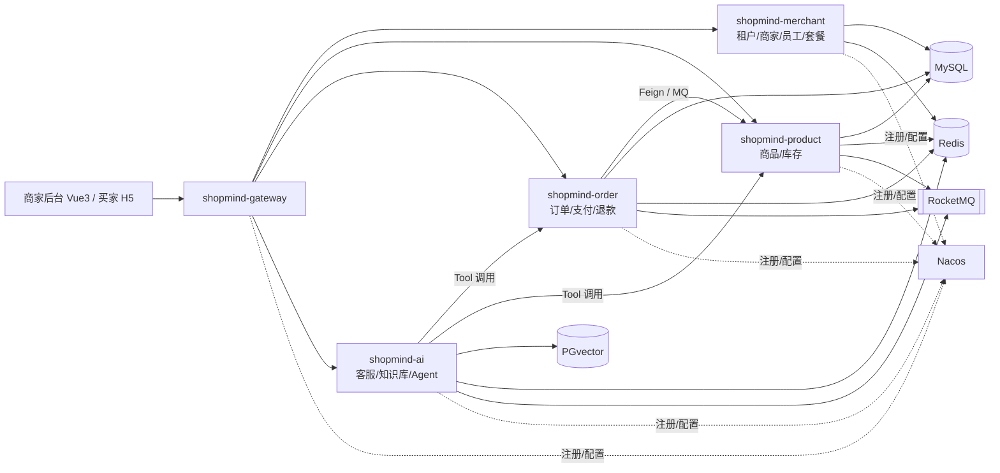

# Day 01 · 项目启动：需求梳理 + 工程骨架 + 本地环境

> 第 1 周：工程骨架与多租户（V1）｜预计 7 小时
> 今天不写业务。目标是把后面 83 天都要用的「地基」一次打好：需求边界、服务划分、版本选型、多模块工程、一键启动的中间件环境。

## 今日目标

- [ ] 写出一期需求文档 `docs/requirements.md`（角色、用例、范围）
- [ ] 写出架构文档 `docs/architecture.md`（服务拆分、端口、版本）
- [ ] 建好 Git 仓库，完成第一次提交
- [ ] 搭好 Maven 多模块骨架：`shopmind-parent` → `shopmind-common-core` + `shopmind-merchant`
- [ ] Docker Compose 一键拉起 MySQL 8.4 + Redis 7.4 + Nacos 3.0
- [ ] `shopmind-merchant` 启动，`/ping` 同时连通 MySQL 和 Redis
- [ ] 完成 2 个小踩坑实验

## 时间安排

| 时间 | 内容 |
| --- | --- |
| 09:00-10:30 | 一、需求梳理 |
| 10:30-12:00 | 二、架构设计与版本选型 |
| 14:00-14:30 | 三、Git 仓库 |
| 14:30-16:00 | 四、Maven 多模块骨架 |
| 16:00-17:00 | 五、Docker Compose 环境 |
| 17:00-17:30 | 六、启动验证 |
| 17:30-18:00 | 七、踩坑实验 |
| 晚上 1h | 笔记 + 面试题 + 提交代码 |

## 前置检查

```bash
java -version          # 需要 21（推荐 Temurin / Liberica 21）
mvn -v                 # 3.9+
docker -v              # Docker Desktop 或 OrbStack
docker compose version # v2
git --version
```

IDEA 建议插件：Lombok（后面用）、MyBatisX（Day 3 用）、Docker。

---

## 一、需求梳理（1.5h）

先想清楚「做什么、不做什么」。范围失控是个人项目做不完的头号原因。

### 1.1 角色

| 角色 | 说明 |
| --- | --- |
| 平台运营 | SaaS 平台方：审核商家入驻、管理套餐（一期简化，可用超级管理员账号代替） |
| 商家管理员 | 租户的老板：注册店铺、管理员工、商品、订单、配置 AI 客服 |
| 商家员工 | 客服 / 运营：按角色权限操作 |
| 买家 | 在店铺下单、咨询 AI 客服（由 buyer-mock 模拟） |
| AI 客服 | 系统角色：代表店铺回答问题、调用工具 |

### 1.2 一期核心用例

| 模块 | 用例 |
| --- | --- |
| 租户 / 商家 | 注册店铺、登录、店铺资料、员工管理、角色权限 |
| 商品 | SPU/SKU、分类、上下架、批量导入、AI 生成文案 |
| 库存 | 设置库存、下单预占、取消释放、库存流水 |
| 订单 | 下单、支付、超时取消、退款、秒杀活动 |
| AI 客服 | 流式对话、店铺知识库问答、查订单/物流、发起退款、转人工 |
| 商家 AI 助手 | 自然语言查经营数据 |
| SaaS | 套餐、AI 用量配额 |

### 1.3 明确不做（写进文档）

- 真实物流对接（物流信息用模拟数据）
- 真实短信（Mock，验证码打印到日志）
- 复杂营销（只保留优惠券的最简版本）
- 精美的 C 端商城（买家端只做最简 H5）
- 真实资金结算（支付宝沙箱）

### 1.4 非功能要求

- 多租户数据严格隔离（任何接口都不能查到别的商家的数据）
- 核心链路可压测、有数据（库存、下单、秒杀、AI 对话）
- 每个模块都有可复现的踩坑实验

**产出**：把以上内容整理进 `docs/requirements.md`，用自己的话改写，加上你觉得缺的用例。

---

## 二、架构设计与版本选型（1.5h）

### 2.1 服务拆分



**拆分原则**（面试会问）：

1. 按业务边界（限界上下文）拆，而不是按技术层拆
2. 数据库按服务独立，服务间不跨库 join，只通过接口或消息交互
3. 变化频率和扩缩容需求不同的拆开：AI 服务吃 IO、调用外部模型、需要单独限流，所以独立
4. 不过度拆分：库存放在 product 里而不是单独一个服务，避免为了拆而拆。但订单和库存跨服务，正好用来练分布式事务

### 2.2 端口规划

| 服务 | 端口 | 数据库 |
| --- | --- | --- |
| shopmind-gateway | 9000 | — |
| shopmind-merchant | 9101 | shopmind_merchant |
| shopmind-product | 9102 | shopmind_product |
| shopmind-order | 9103 | shopmind_order |
| shopmind-ai | 9104 | shopmind_ai + PGvector |
| shopmind-buyer-mock | 9105 | — |
| MySQL | 3306 | |
| Redis | 6379 | |
| Nacos | 8848（API）/ 9848（gRPC）/ 8088（控制台） | |

> 业务服务统一用 9xxx，避免和 Nacos 3 控制台默认的 8080 冲突。

### 2.3 版本选型

| 组件 | 版本 | 理由 |
| --- | --- | --- |
| JDK | 21 | LTS，有虚拟线程（第 2 周线程池实验要对比） |
| Spring Boot | 3.5.x | Spring Cloud Alibaba 2025.0.x 官方适配 3.5.x |
| Spring Cloud | 2025.0.0 | 与 Boot 3.5 配套 |
| Spring Cloud Alibaba | 2025.0.0.0 | 对应 Nacos 3.0.3、Sentinel 1.8.9、Seata 2.5.0、RocketMQ 5.3.1 |
| MySQL | 8.4 LTS | |
| Redis | 7.4 | |
| Nacos | 3.0.3 | 与 SCA 2025.0.0.0 对应 |

**为什么不上 Spring Boot 4.0？** SCA 已经有 2025.1.x 适配 Boot 4.0，但 MyBatis-Plus、Sa-Token、Seata 等周边生态对 Boot 4 的适配还在跟进。学习项目要把时间花在分布式和 AI 上，不是花在解决版本兼容上。面试时这就是一个「版本选型考虑生态成熟度」的好答案。

> 选型依据：Spring Cloud Alibaba 官方版本说明，2025.0.x 适配 Spring Boot 3.5.x 和 Spring Cloud 2025.0.x，组件版本为 Nacos 3.0.3 / Sentinel 1.8.9 / Seata 2.5.0 / RocketMQ 5.3.1。

### 2.4 目录结构

```text
shopmind/
├── pom.xml                      # shopmind-parent
├── shopmind-common/
│   ├── pom.xml
│   └── shopmind-common-core/    # 统一返回、错误码、异常、工具类
├── shopmind-merchant/           # 今天只建这一个业务服务
├── docker/
│   ├── docker-compose.yml
│   ├── .env                     # 不提交
│   ├── .env.example             # 提交
│   └── mysql/init/01-init.sql
├── docs/
│   ├── requirements.md
│   ├── architecture.md
│   └── notes/                   # 每日笔记
└── .gitignore
```

其他服务（gateway、product、order、ai）用到时再建，不要提前建一堆空模块。

**产出**：把 2.1-2.4 整理进 `docs/architecture.md`。

---

## 三、Git 仓库（0.5h）

```bash
mkdir shopmind && cd shopmind
git init -b main
```

`.gitignore`：

```gitignore
target/
*.iml
../../../.idea/
.vscode/
*.log
logs/
docker/data/
docker/.env
.DS_Store
```

**提交规范**（Conventional Commits，后面每天都这样提交）：

```text
feat(merchant): 新增商家注册接口
fix(product): 修复缓存击穿
lab(L01): 复现 SETNX 误删锁
docs: 更新 Day 01 笔记
chore: 初始化工程骨架
```

**分支约定**：`main` 稳定可演示；`dev` 日常开发；`lab/Lxx-描述` 踩坑实验。

在 GitHub 新建仓库 `shopmind`（先私有，项目成型后再公开）。

---

## 四、Maven 多模块骨架（1.5h）

### 4.1 根 `pom.xml`

```xml
<?xml version="1.0" encoding="UTF-8"?>
<project xmlns="http://maven.apache.org/POM/4.0.0"
         xmlns:xsi="http://www.w3.org/2001/XMLSchema-instance"
         xsi:schemaLocation="http://maven.apache.org/POM/4.0.0 https://maven.apache.org/xsd/maven-4.0.0.xsd">
    <modelVersion>4.0.0</modelVersion>

    <parent>
        <groupId>org.springframework.boot</groupId>
        <artifactId>spring-boot-starter-parent</artifactId>
        <!-- 使用 3.5.x 的最新补丁版本 -->
        <version>3.5.6</version>
        <relativePath/>
    </parent>

    <groupId>com.shopmind</groupId>
    <artifactId>shopmind-parent</artifactId>
    <version>0.1.0-SNAPSHOT</version>
    <packaging>pom</packaging>
    <name>shopmind-parent</name>

    <modules>
        <module>shopmind-common</module>
        <module>shopmind-merchant</module>
    </modules>

    <properties>
        <java.version>21</java.version>
        <project.build.sourceEncoding>UTF-8</project.build.sourceEncoding>
        <spring-cloud.version>2025.0.0</spring-cloud.version>
        <spring-cloud-alibaba.version>2025.0.0.0</spring-cloud-alibaba.version>
    </properties>

    <!-- 只声明版本，不引入依赖 -->
    <dependencyManagement>
        <dependencies>
            <dependency>
                <groupId>org.springframework.cloud</groupId>
                <artifactId>spring-cloud-dependencies</artifactId>
                <version>${spring-cloud.version}</version>
                <type>pom</type>
                <scope>import</scope>
            </dependency>
            <dependency>
                <groupId>com.alibaba.cloud</groupId>
                <artifactId>spring-cloud-alibaba-dependencies</artifactId>
                <version>${spring-cloud-alibaba.version}</version>
                <type>pom</type>
                <scope>import</scope>
            </dependency>
            <!-- 内部模块统一版本 -->
            <dependency>
                <groupId>com.shopmind</groupId>
                <artifactId>shopmind-common-core</artifactId>
                <version>${project.version}</version>
            </dependency>
        </dependencies>
    </dependencyManagement>
</project>
```

### 4.2 `shopmind-common/pom.xml`

```xml
<project xmlns="http://maven.apache.org/POM/4.0.0"
         xmlns:xsi="http://www.w3.org/2001/XMLSchema-instance"
         xsi:schemaLocation="http://maven.apache.org/POM/4.0.0 https://maven.apache.org/xsd/maven-4.0.0.xsd">
    <modelVersion>4.0.0</modelVersion>
    <parent>
        <groupId>com.shopmind</groupId>
        <artifactId>shopmind-parent</artifactId>
        <version>0.1.0-SNAPSHOT</version>
    </parent>
    <artifactId>shopmind-common</artifactId>
    <packaging>pom</packaging>
    <modules>
        <module>shopmind-common-core</module>
    </modules>
</project>
```

### 4.3 `shopmind-common-core`

`pom.xml`：

```xml
<project xmlns="http://maven.apache.org/POM/4.0.0"
         xmlns:xsi="http://www.w3.org/2001/XMLSchema-instance"
         xsi:schemaLocation="http://maven.apache.org/POM/4.0.0 https://maven.apache.org/xsd/maven-4.0.0.xsd">
    <modelVersion>4.0.0</modelVersion>
    <parent>
        <groupId>com.shopmind</groupId>
        <artifactId>shopmind-common</artifactId>
        <version>0.1.0-SNAPSHOT</version>
    </parent>
    <artifactId>shopmind-common-core</artifactId>
</project>
```

`src/main/java/com/shopmind/common/core/result/Result.java`：

```java
package com.shopmind.common.core.result;

/**
 * 统一返回体。code = 0 表示成功。
 */
public record Result<T>(int code, String msg, T data) {

    public static <T> Result<T> ok(T data) {
        return new Result<>(0, "ok", data);
    }

    public static <T> Result<T> ok() {
        return ok(null);
    }

    public static <T> Result<T> fail(int code, String msg) {
        return new Result<>(code, msg, null);
    }

    public static <T> Result<T> fail(ErrorCode errorCode) {
        return fail(errorCode.code(), errorCode.msg());
    }
}
```

`src/main/java/com/shopmind/common/core/result/ErrorCode.java`：

```java
package com.shopmind.common.core.result;

/**
 * 错误码约定：
 * 1xxxx 通用  2xxxx 商家  3xxxx 商品/库存  4xxxx 订单/支付  5xxxx AI
 */
public interface ErrorCode {
    int code();
    String msg();
}
```

`src/main/java/com/shopmind/common/core/result/CommonErrorCode.java`：

```java
package com.shopmind.common.core.result;

public enum CommonErrorCode implements ErrorCode {
    PARAM_ERROR(10001, "参数错误"),
    UNAUTHORIZED(10002, "未登录"),
    FORBIDDEN(10003, "无权限"),
    TOO_MANY_REQUESTS(10004, "请求过于频繁"),
    SYSTEM_ERROR(19999, "系统繁忙，请稍后重试");

    private final int code;
    private final String msg;

    CommonErrorCode(int code, String msg) {
        this.code = code;
        this.msg = msg;
    }

    @Override public int code() { return code; }
    @Override public String msg() { return msg; }
}
```

`src/main/java/com/shopmind/common/core/exception/BizException.java`：

```java
package com.shopmind.common.core.exception;

import com.shopmind.common.core.result.ErrorCode;

public class BizException extends RuntimeException {
    private final int code;

    public BizException(ErrorCode errorCode) {
        super(errorCode.msg());
        this.code = errorCode.code();
    }

    public BizException(ErrorCode errorCode, String detail) {
        super(detail);
        this.code = errorCode.code();
    }

    public int getCode() { return code; }
}
```

> 全局异常处理器放 `shopmind-common-web`，明天（Day 2）做。

### 4.4 `shopmind-merchant`

`pom.xml`：

```xml
<project xmlns="http://maven.apache.org/POM/4.0.0"
         xmlns:xsi="http://www.w3.org/2001/XMLSchema-instance"
         xsi:schemaLocation="http://maven.apache.org/POM/4.0.0 https://maven.apache.org/xsd/maven-4.0.0.xsd">
    <modelVersion>4.0.0</modelVersion>
    <parent>
        <groupId>com.shopmind</groupId>
        <artifactId>shopmind-parent</artifactId>
        <version>0.1.0-SNAPSHOT</version>
    </parent>
    <artifactId>shopmind-merchant</artifactId>

    <dependencies>
        <dependency>
            <groupId>com.shopmind</groupId>
            <artifactId>shopmind-common-core</artifactId>
        </dependency>
        <dependency>
            <groupId>org.springframework.boot</groupId>
            <artifactId>spring-boot-starter-web</artifactId>
        </dependency>
        <dependency>
            <groupId>org.springframework.boot</groupId>
            <artifactId>spring-boot-starter-actuator</artifactId>
        </dependency>
        <!-- 今天只用 JDBC 验证连通性，Day 3 换成 MyBatis-Plus -->
        <dependency>
            <groupId>org.springframework.boot</groupId>
            <artifactId>spring-boot-starter-jdbc</artifactId>
        </dependency>
        <dependency>
            <groupId>com.mysql</groupId>
            <artifactId>mysql-connector-j</artifactId>
            <scope>runtime</scope>
        </dependency>
        <dependency>
            <groupId>org.springframework.boot</groupId>
            <artifactId>spring-boot-starter-data-redis</artifactId>
        </dependency>
        <dependency>
            <groupId>org.springframework.boot</groupId>
            <artifactId>spring-boot-starter-test</artifactId>
            <scope>test</scope>
        </dependency>
    </dependencies>

    <build>
        <plugins>
            <plugin>
                <groupId>org.springframework.boot</groupId>
                <artifactId>spring-boot-maven-plugin</artifactId>
            </plugin>
        </plugins>
    </build>
</project>
```

启动类 `com/shopmind/merchant/MerchantApplication.java`：

```java
package com.shopmind.merchant;

import org.springframework.boot.SpringApplication;
import org.springframework.boot.autoconfigure.SpringBootApplication;

@SpringBootApplication
public class MerchantApplication {
    public static void main(String[] args) {
        SpringApplication.run(MerchantApplication.class, args);
    }
}
```

连通性检查 `com/shopmind/merchant/controller/PingController.java`：

```java
package com.shopmind.merchant.controller;

import com.shopmind.common.core.result.Result;
import org.springframework.data.redis.connection.RedisConnection;
import org.springframework.data.redis.core.RedisCallback;
import org.springframework.data.redis.core.StringRedisTemplate;
import org.springframework.jdbc.core.JdbcTemplate;
import org.springframework.web.bind.annotation.GetMapping;
import org.springframework.web.bind.annotation.RestController;

import java.time.LocalDateTime;
import java.util.Map;

@RestController
public class PingController {

    private final JdbcTemplate jdbcTemplate;
    private final StringRedisTemplate redisTemplate;

    public PingController(JdbcTemplate jdbcTemplate, StringRedisTemplate redisTemplate) {
        this.jdbcTemplate = jdbcTemplate;
        this.redisTemplate = redisTemplate;
    }

    @GetMapping("/ping")
    public Result<Map<String, Object>> ping() {
        String mysqlVersion = jdbcTemplate.queryForObject("select version()", String.class);
        String redisPong = redisTemplate.execute((RedisCallback<String>) RedisConnection::ping);
        return Result.ok(Map.of(
                "mysql", mysqlVersion,
                "redis", redisPong,
                "time", LocalDateTime.now().toString()
        ));
    }
}
```

`src/main/resources/application.yml`：

```yaml
server:
  port: 9101

spring:
  application:
    name: shopmind-merchant
  datasource:
    url: jdbc:mysql://localhost:3306/shopmind_merchant?useUnicode=true&characterEncoding=utf8&serverTimezone=Asia/Shanghai&useSSL=false&allowPublicKeyRetrieval=true
    username: shopmind
    password: ${DB_PASSWORD:shopmind123}
    hikari:
      maximum-pool-size: 10
      minimum-idle: 2
  data:
    redis:
      host: localhost
      port: 6379
      password: ${REDIS_PASSWORD:redis123}
      timeout: 3s

management:
  endpoints:
    web:
      exposure:
        include: health,info
  endpoint:
    health:
      show-details: always
```

---

## 五、Docker Compose 环境（1h）

### 5.1 `docker/.env.example`（复制为 `.env` 再改）

```bash
MYSQL_ROOT_PASSWORD=root123
REDIS_PASSWORD=redis123
# 生成方式：openssl rand -base64 32
NACOS_AUTH_TOKEN=请替换为32字节以上的Base64字符串
NACOS_AUTH_IDENTITY_KEY=shopmind
NACOS_AUTH_IDENTITY_VALUE=shopmind-secret
```

### 5.2 `docker/docker-compose.yml`

```yaml
name: shopmind

services:
  mysql:
    image: mysql:8.4
    container_name: sm-mysql
    restart: unless-stopped
    environment:
      MYSQL_ROOT_PASSWORD: ${MYSQL_ROOT_PASSWORD}
      TZ: Asia/Shanghai
    command:
      - --character-set-server=utf8mb4
      - --collation-server=utf8mb4_0900_ai_ci
    ports:
      - "3306:3306"
    volumes:
      - ./data/mysql:/var/lib/mysql
      - ./mysql/init:/docker-entrypoint-initdb.d
    healthcheck:
      test: ["CMD", "mysqladmin", "ping", "-h", "localhost", "-p${MYSQL_ROOT_PASSWORD}"]
      interval: 10s
      timeout: 5s
      retries: 10

  redis:
    image: redis:7.4
    container_name: sm-redis
    restart: unless-stopped
    command: redis-server --requirepass ${REDIS_PASSWORD} --appendonly yes
    ports:
      - "6379:6379"
    volumes:
      - ./data/redis:/data

  nacos:
    image: nacos/nacos-server:v3.0.3
    container_name: sm-nacos
    restart: unless-stopped
    environment:
      MODE: standalone
      NACOS_AUTH_ENABLE: "true"
      NACOS_AUTH_TOKEN: ${NACOS_AUTH_TOKEN}
      NACOS_AUTH_IDENTITY_KEY: ${NACOS_AUTH_IDENTITY_KEY}
      NACOS_AUTH_IDENTITY_VALUE: ${NACOS_AUTH_IDENTITY_VALUE}
      TZ: Asia/Shanghai
    ports:
      - "8848:8848"   # HTTP API
      - "9848:9848"   # gRPC，客户端必须能访问
      - "8088:8080"   # Nacos 3 控制台
    volumes:
      - ./data/nacos:/home/nacos/data
```

> Nacos 单机模式先用内置存储，够学习用。Nacos 3 的控制台独立在 8080 端口，这里映射到宿主机 8088。如果启动报错，`docker logs sm-nacos` 看缺了哪个环境变量。

### 5.3 `docker/mysql/init/01-init.sql`

```sql
-- 每个服务一个库：服务间数据隔离，不跨库 join
CREATE DATABASE IF NOT EXISTS shopmind_merchant DEFAULT CHARACTER SET utf8mb4 COLLATE utf8mb4_0900_ai_ci;
CREATE DATABASE IF NOT EXISTS shopmind_product  DEFAULT CHARACTER SET utf8mb4 COLLATE utf8mb4_0900_ai_ci;
CREATE DATABASE IF NOT EXISTS shopmind_order    DEFAULT CHARACTER SET utf8mb4 COLLATE utf8mb4_0900_ai_ci;
CREATE DATABASE IF NOT EXISTS shopmind_ai       DEFAULT CHARACTER SET utf8mb4 COLLATE utf8mb4_0900_ai_ci;

-- 应用账号，不用 root 连库
CREATE USER IF NOT EXISTS 'shopmind'@'%' IDENTIFIED BY 'shopmind123';
GRANT ALL PRIVILEGES ON `shopmind\_%`.* TO 'shopmind'@'%';
FLUSH PRIVILEGES;
```

> 初始化脚本**只在数据目录为空时执行一次**。改了脚本要生效，需要 `docker compose down` 并删掉 `docker/data/mysql`。这本身就是一个常见的坑。

---

## 六、启动验证（0.5h）

```bash
cd docker
cp .env.example .env   # 并填好 NACOS_AUTH_TOKEN
docker compose up -d
docker compose ps      # 三个容器都是 running / healthy

# MySQL：应能看到 4 个 shopmind_ 库
docker exec -it sm-mysql mysql -ushopmind -pshopmind123 -e "show databases;"

# Redis：返回 PONG
docker exec -it sm-redis redis-cli -a redis123 ping

# Nacos：浏览器打开 http://localhost:8088 ，首次登录按提示设置 nacos 用户密码
```

启动 merchant（IDEA 运行 `MerchantApplication`，或）：

```bash
cd ..
mvn clean install -DskipTests
mvn -pl shopmind-merchant spring-boot:run
```

验证：

```bash
curl http://localhost:9101/ping
# {"code":0,"msg":"ok","data":{"mysql":"8.4.x","redis":"PONG","time":"..."}}

curl http://localhost:9101/actuator/health
# status: UP，components 里有 db 和 redis
```

都通了就提交：

```bash
git add .
git commit -m "chore: 初始化工程骨架与本地中间件环境"
git remote add origin git@github.com:<你的用户名>/shopmind.git
git push -u origin main
```

---

## 七、踩坑实验（0.5h）

今天的坑不大，但都是新项目第一天最常遇到的。按「复现 → 观察 → 修复」做完，写进笔记。

### D01-1 · utf8 存不了 emoji

商家店铺名、买家咨询消息里经常有 emoji，这是真实线上问题。

**复现**：

```sql
USE shopmind_merchant;
CREATE TABLE t_lab_charset (
  id   BIGINT PRIMARY KEY AUTO_INCREMENT,
  name VARCHAR(64)
) DEFAULT CHARSET = utf8;   -- 实际是 utf8mb3

INSERT INTO t_lab_charset(name) VALUES ('小龙的店🛒');
```

**现象**：`ERROR 1366 (HY000): Incorrect string value: '\xF0\x9F\x9B\x92' ...`

**原理**：MySQL 的 `utf8` 是 `utf8mb3`，每个字符最多 3 字节；emoji 需要 4 字节。

**修复**：

```sql
ALTER TABLE t_lab_charset CONVERT TO CHARACTER SET utf8mb4 COLLATE utf8mb4_0900_ai_ci;
INSERT INTO t_lab_charset(name) VALUES ('小龙的店🛒');   -- 成功
DROP TABLE t_lab_charset;
```

**结论**：库、表、连接三层都要是 utf8mb4。我们在 compose 的 `command` 和建库语句里已经统一。

### D01-2 · Public Key Retrieval is not allowed

**复现**：

1. 把 `application.yml` 里 JDBC URL 的 `&allowPublicKeyRetrieval=true` 删掉
2. `docker compose restart mysql`（重启后服务端清空了密码缓存）
3. 启动 merchant 并访问 `/ping`

**现象**：`java.sql.SQLNonTransientConnectionException: Public Key Retrieval is not allowed`。有时第一次能连上，有时连不上，取决于服务端是否已缓存该用户的认证信息。这种「偶现」最折磨人。

**原理**：MySQL 8 默认认证插件是 `caching_sha2_password`。在非 SSL 连接、服务端没有缓存时，客户端需要拿服务端公钥来加密密码，驱动默认禁止自动获取公钥（防中间人）。

**修复**：本地开发加 `allowPublicKeyRetrieval=true`；生产环境用 SSL 连接，或者预先配置服务端公钥。

### D01-3（选做）· 版本不兼容

1. 在 merchant 里临时加入依赖 `org.springframework.cloud:spring-cloud-starter`
2. 把根 pom 的 `spring-cloud.version` 改成 `2023.0.3`
3. 启动，观察 Spring Cloud 兼容性校验的报错信息
4. `mvn -pl shopmind-merchant dependency:tree | grep spring-cloud` 看实际引入的版本
5. 改回 `2025.0.0`，删掉临时依赖

**结论**：Spring Boot、Spring Cloud、Spring Cloud Alibaba 必须按官方版本对应关系选，用 `dependencyManagement` 的 BOM 统一管理，不在子模块里写版本号。

---

## 验收清单

- [ ] `docs/requirements.md`、`docs/architecture.md` 已完成
- [ ] `docker compose ps` 三个容器正常
- [ ] Nacos 控制台能登录
- [ ] `curl localhost:9101/ping` 返回 MySQL 版本和 PONG
- [ ] `/actuator/health` 为 UP
- [ ] D01-1、D01-2 已复现并修复
- [ ] 代码已推送到 GitHub，提交信息符合规范
- [ ] 写完 `docs/notes/day01.md`

## 今日面试题

**1. 微服务怎么拆？你的项目为什么这样拆？**
要点：按业务边界拆；数据库按服务独立；考虑变化频率和扩缩容（AI 服务单独限流、单独扩容）；避免过度拆分（库存放在商品服务里）；拆分后要承担分布式事务和链路追踪的成本。

**2. `dependencyManagement` 和 `dependencies` 有什么区别？BOM 的 `import` 作用是什么？**
要点：前者只声明版本、不引入依赖，子模块引用时可以不写版本；后者直接引入。`scope=import` 把另一个 pom 的 dependencyManagement 合并进来，用来统一管理一整套框架版本。

**3. MySQL 的 utf8 和 utf8mb4 有什么区别？**
要点：utf8 即 utf8mb3，最多 3 字节，存不了 emoji 和部分生僻字；utf8mb4 最多 4 字节。库、表、字段、连接都要统一。

**4. 为什么选 Spring Boot 3.5 而不是 4.0？**
要点：版本选型要看整个生态的成熟度，不只看框架本身；SCA 2025.0.x 官方适配 Boot 3.5；周边组件（MyBatis-Plus、Seata、Sa-Token）适配情况；学习和生产都优先选稳定组合。

**5. Docker 里的 MySQL 初始化脚本为什么没生效？**
要点：`/docker-entrypoint-initdb.d` 只在数据目录为空时执行；数据卷已存在就会跳过。

## 今日笔记模板（`docs/notes/day01.md`）

```markdown
# Day 01 笔记

## 今天完成了
-

## 遇到的问题与解决
| 问题 | 原因 | 解决 |
| --- | --- | --- |

## 踩坑实验记录
### D01-1 utf8 emoji
- 现象：
- 原理：
- 修复：

### D01-2 Public Key Retrieval
- 现象：
- 原理：
- 修复：

## 面试题我的回答（用自己的话）

## 明天要注意
```

## 明日预告：Day 02 · 网关与基础设施

- 新建 `shopmind-gateway` 和 `shopmind-common-web`
- merchant 和 gateway 注册到 Nacos，配置放到 Nacos 配置中心
- Gateway 路由转发
- 全局异常处理、参数校验、统一返回包装
- TraceId 全链路日志（MDC），为后面排查并发问题做准备

> 做完了对我说「开始学习第 2 天」。今天哪里卡住了，也直接告诉我。
